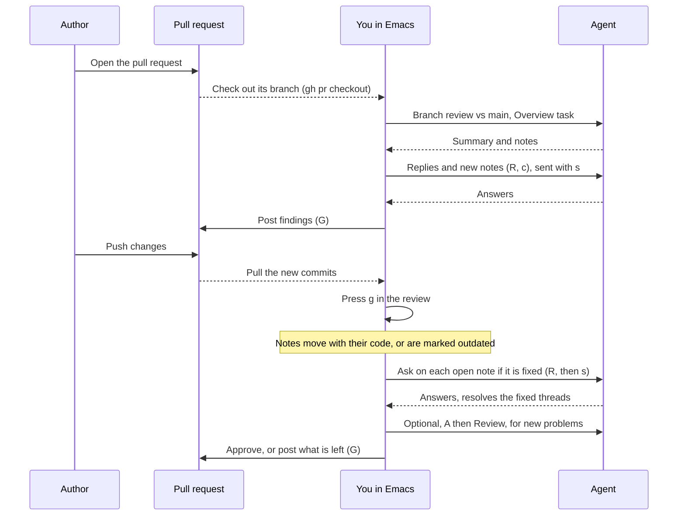

# agent-notes

Go through the changes in a git repository with an AI agent (GitHub Copilot CLI, Claude Code, the Codex CLI or the Grok CLI), inside Emacs.

The diff is shown in a Magit-style buffer, unified or side by side, with the syntax highlighting of each file's major mode. You give the agent a task, such as a bug review, an overview of the important changes, a diagram, or your own instructions. Its notes appear under the lines they refer to. You can reply, add your own notes, and resolve threads. Your comments are queued, and nothing goes to the agent until you send them all with `s`. If you ask for a change, the agent edits the code; when it suggests a change in a note, `a` applies it. You can also edit files yourself. Either way, the diff refreshes and the notes move with the code.

```
stats.py
@@ def average(xs):
    5     5      return total / len(xs)
          8 +def median(xs):
          9 +    s = sorted(xs)
         10 +    return s[len(s) // 2]
            ┌ #1  agent  issue  open  1 unsent
            │ `s[len(s) // 2]` is wrong for even-length lists. `median([1,2,3,4])` returns 3 instead of 2.5.
            │
            │ ↳ you  unsent
            │   Please fix it.
            └
```

## Requirements

- Emacs 29.1 or newer
- Magit 4.0 or newer (with `magit-section` and `transient`)
- One agent CLI, installed and signed in:
  - the [GitHub Copilot CLI](https://github.com/github/copilot-cli) (`copilot`), the default;
  - [Claude Code](https://docs.anthropic.com/en/docs/claude-code) (`claude`);
  - or the [OpenAI Codex CLI](https://github.com/openai/codex) (`codex`);
  - or the xAI Grok CLI (`grok`, Grok Build).
- Optional, to post notes to GitHub: the [GitHub CLI](https://cli.github.com) (`gh`, `brew install gh`), signed in with `gh auth login`. See [Posting to GitHub](#posting-to-github).

## Setup

From MELPA:

```elisp
(use-package agent-notes
  :ensure t
  :bind (("C-c g a" . agent-notes-menu)
         ("C-c g r" . agent-notes-review)
         ("C-c g o" . agent-notes-open))
  :init (with-eval-after-load 'magit (agent-notes-magit-mode 1)))
```

From a clone:

```elisp
(use-package agent-notes
  :ensure nil
  :load-path "/path/to/agent-notes"
  :bind (("C-c g a" . agent-notes-menu)
         ("C-c g r" . agent-notes-review)
         ("C-c g o" . agent-notes-open))
  :init (with-eval-after-load 'magit
          (require 'agent-notes-magit)
          (agent-notes-magit-mode 1)))
```

`agent-notes-magit-mode` adds the Magit integration: `@` in Magit buffers and in `magit-dispatch`, and the status line. It is off by default; the `:init` line turns it on as soon as Magit is loaded, without loading the rest of agent-notes. The commands are autoloaded, so the package itself loads on first use.

## Usage

- `M-x agent-notes-menu` (or, with `agent-notes-magit-mode`, `@` in any Magit buffer or in `magit-dispatch`) offers these commands:
  - `w` review the working tree
  - `s` review the staged changes
  - `b` review the branch
  - `c` review a commit or a range
  - `l` open the latest review
  - `o` open any previous review
  - `a` choose the agent
- `M-x agent-notes-review` asks for the scope, then the task.
  - **Working tree**: uncommitted changes (staged, unstaged and untracked) compared to `HEAD`.
  - **Staged**: only what is staged, compared to `HEAD`. Useful just before committing.
  - **Branch**: everything since the current branch forked from a base branch (default `origin/HEAD`, then `main`/`master`). Uncommitted work is included unless `agent-notes-branch-include-uncommitted` is nil.
  - **Commit or range**: a commit compared to its (first) parent, such as `HEAD` or `a1b2c3d`; or a range, `A..B` (from `A` to `B`) or `A...B` (what `B` added since it forked from `A`). An empty side means `HEAD`, so `HEAD~3..` is the last three commits. In a Magit log, the default is the commit at point; with a region over several commits, it is the range covering all of them.
- With `agent-notes-magit-mode`, the Magit status buffer shows the latest review ("Agent review: … · 2 open, 1 unsent"). `RET` on that line opens it. Turn it off with `agent-notes-magit-status-section`.

A review of a commit stays on that commit. `g` and saving files don't change it, because it is stored by the commit's id. A range is kept as you typed it, so `g` follows the branches it names, like a branch review does.

In staged, commit and range reviews, the diff is not the working tree. The agent still edits the working tree, and `a` applies suggestions there, so those changes don't appear in the review's diff. The log says which files changed ("not in its diff; see them in Magit"). `RET` opens the working-tree file at the line with the same code, even if it has moved since the commit.

### Tasks

The task tells the agent what to do with the diff. The built-in tasks are:

- **Review**: find bugs, risks and missing tests. Where the fix is clear, a note carries a suggested change.
- **Overview**: explain only the most important changes. The summary covers what changed and why, in reading order, with a small diagram when several parts interact. It adds about 3–8 `info` notes on the key lines.
- **Diagram**: a box-and-arrow drawing of the changed parts and how they connect, with a short explanation.

You can also pick "Custom instructions…" or type your own text, for example "explain how the caching works". In Vertico, use `M-RET` to submit text that partially matches a task name. Add your own tasks to `agent-notes-tasks`. Press `A` in a review to give the agent another task; new notes are added to the existing ones, and each task's summary is kept.

### Choosing the agent

Set `agent-notes-agent` to `copilot` (the default), `claude`, `codex` or `grok`. You can also switch for the current Emacs session with `@` in a review, or `a` in `agent-notes-menu`. The header line shows the agent that will run the next request ("Claude Code: idle"). It also shows the file the cursor is in, in bold, so you always know which file you are looking at. Hunk headings show only the surrounding function or class, without line numbers or counts.

Each review remembers its session with an agent. If you switch agents in the middle of a review, the next request starts a new session with the new agent, and the log says so. The new agent doesn't remember earlier requests. Replies still work well, because each one includes its whole thread and the code around it.

| Agent       | Prompt   | Session                                                               | Permissions                                                                                                                                                       |
| ----------- | -------- | --------------------------------------------------------------------- | ----------------------------------------------------------------------------------------------------------------------------------------------------------------- |
| Copilot     | argument | `--session-id <uuid>`                                                 | `--allow-tool` for each of `agent-notes-allowed-tools`, plus `write` when edits are allowed                                                                       |
| Claude Code | stdin    | `--session-id <uuid>` the first time, then `--resume <uuid>`          | `--allowedTools`, where `shell(git diff)` becomes `Bash(git diff:*)`; `--permission-mode acceptEdits` when edits are allowed, otherwise the edit tools are denied |
| Codex       | argument | `codex exec`, then `codex exec resume <id>`, with the id Codex prints | `--sandbox workspace-write` when edits are allowed, otherwise `read-only`; the answer is read from `--output-last-message`                                        |
| Grok        | argument | `--session-id <uuid>` the first time, then `--resume <uuid>`          | `--allow` and `--deny` rules, written like Claude Code's; `--permission-mode acceptEdits` when edits are allowed, otherwise the edit tools are denied             |

The programs are `agent-notes-copilot-program`, `agent-notes-claude-program`, `agent-notes-codex-program` and `agent-notes-grok-program`. Extra arguments, such as the model, go in `agent-notes-copilot-extra-args`, `agent-notes-claude-extra-args`, `agent-notes-codex-extra-args` and `agent-notes-grok-extra-args`. To add another CLI, add an entry to `agent-notes-agents` with a function that builds its arguments; its docstring describes the format. Every prompt is the same whichever agent runs it.

### Keys in the review buffer

Press `?` (or `h`) for a menu with all of these.

| Key             | Action                                                                                                              |
| --------------- | ------------------------------------------------------------------------------------------------------------------- |
| `n` / `p`       | Next / previous open note, centered in the window. Resolved notes are skipped; with `C-u`, they are included.       |
| `N` / `P`       | Next / previous open note written by the agent                                                                      |
| `M-n` / `M-p`   | Next / previous hunk, across files                                                                                  |
| `}` / `{`       | Next / previous file                                                                                                |
| `l`             | Jump to any note, resolved ones included, from a list                                                               |
| `TAB`           | Fold the file, hunk or note at point. Resolved notes start folded.                                                  |
| `^`, `1`–`4`    | Parent section, show levels (as in Magit)                                                                           |
| `v`             | Switch between unified and side-by-side views. Side by side, notes sit in the column of the side they are on.       |
| `#`             | Show / hide line numbers                                                                                            |
| `c`             | New note on the line at point. In the side-by-side view, the side at point counts. Elsewhere, write a general note. |
| `r`             | Resolve / reopen the note at point                                                                                  |
| `e` / `k`       | Edit / delete your unsent comment (or your whole unsent note)                                                       |
| `R`             | Reply to the note at point                                                                                          |
| `a`             | Apply the change suggested in the note at point                                                                     |
| `G`             | Post the note's comment (or the agent's GitHub draft) to the pull request; `C-u` chooses the pull request           |
| `s`             | Send all unsent comments to the agent                                                                               |
| `A`             | Give the agent a task                                                                                               |
| `@`             | Choose the agent (Copilot, Claude Code, Codex, Grok)                                                                |
| `g`             | Refresh the diff (same scope and base) and move notes with their code                                               |
| `RET` / `o`     | Open the file at that line, to read or edit it (on a diagram: open its Graphviz source)                             |
| `$`             | Show the log: what was sent, how long it took, what came back and what changed                                      |
| `x` / `C-c C-k` | Abort the running agent request                                                                                     |

In the compose buffer, `C-c C-c` saves and `C-c C-k` cancels.

Side by side, the cursor stays in its column. `C-f` / right-arrow at the end of the text of a column goes to the start of the same column on the next line, `C-b` / left-arrow at its start goes to the end of the previous line, and `C-a` / `C-e` go to the start / end of the column, not of the whole line. This holds for code and for notes, and `n` / `p` put the cursor at the start of a note's text.

### Editing code during a review

Press `RET` on a line or note to open the file at that line, in another window. Edit it and save. The review refreshes about half a second later, and the notes move with their code. You can turn this off with `agent-notes-refresh-on-save`, and refresh by hand with `g`.

While the agent is working, saving doesn't refresh. Its changes are picked up when it finishes. Buffers of files that the agent changed are reverted if you have no unsaved edits in them; otherwise the log warns you.

### Suggested changes

When the agent knows the exact fix for a few lines, its note shows a "Suggested change" with the old lines (`-`) and the new ones (`+`). Press `a` on the note to apply it. The file is changed and saved, the note is resolved, and the diff refreshes. Undo works as usual in the file's buffer. You can also ask for a suggestion in a reply ("suggest a fix") rather than asking the agent to edit.

Applying works like search and replace, not by line numbers. The agent gives the exact lines it replaces (`original`) along with the new code, and `a` looks for those lines in the file, near the note. The `-` lines are exactly what gets replaced. If the agent repeats a neighbouring line for context, such as the function's signature, that line is part of what's replaced and does not end up in the file twice. Suggestions whose `original` is not in the file are dropped, and the log says so. If the code changed after the suggestion was made, `a` refuses instead of guessing.

Before saving, `a` checks the result. It looks for brackets or strings that no longer balance, a new syntax error (in tree-sitter modes), or a line that now appears twice. If it finds one, it asks whether to keep the change; answering `n` leaves the file as it was.

### Diagrams

The Overview and Diagram tasks can draw a diagram at the top of the summary. You can also type your own instructions, such as "draw how a request flows through the new middleware".

If [Graphviz](https://graphviz.org) is installed (`brew install graphviz`), the agent writes diagrams in DOT and they are shown as images in the colours of your theme. New parts are drawn **bold** and changed parts dashed. Press `RET` on a diagram to open its source, in `graphviz-dot-mode` if you have it; there, `C-c C-p` shows a zoomable preview. Without Graphviz, or in a terminal, the agent draws plain-text box-and-arrow diagrams instead. Code blocks are cut at the window edge instead of wrapping, so these drawings stay intact. `agent-notes-diagram-format` chooses between the two.

### When you are done

When every note is resolved and nothing is unsent, the review says so, and the Magit status line shows "all resolved ✓". Commit as usual with Magit. The review stays in `.git/agent-notes/` as history and can be reopened with `o` in the menu. For your next round of changes, start a new review. For a pull request that gets new commits, keep the same review; see [Reviewing a pull request](#reviewing-a-pull-request).

### Notifications

When the agent finishes a request, or fails, you get a desktop notification, so you can do something else while it works. On macOS, install [terminal-notifier](https://github.com/julienXX/terminal-notifier) (`brew install terminal-notifier`): clicking its notification brings Emacs to the front. Without it, the notification comes from `osascript`, which shows it under Script Editor, so clicking it opens Script Editor instead of Emacs. Elsewhere it uses D-Bus. Set `agent-notes-notify` to `unfocused` to be notified only when Emacs is not in front, or to `nil` to turn it off. `agent-notes-notify-function` replaces how the notification is shown.

### Posting to GitHub

After a review you may want a finding to end up on the pull request. There are two ways, and in both you see and confirm the text before anything is posted.

**Ask the agent.** Reply on the note in plain words, for example "post this to GitHub" or "leave a comment about this on the PR", and send it with `s`. The agent doesn't run `gh` itself. It writes the comment as it should appear on GitHub (self-contained, since readers there can't see your thread) and Emacs attaches it to the note as a draft. The note then shows "GitHub draft: press G". Press `G` on it to review the draft, edit it, and post.

**Do it yourself.** Put the cursor on a note (or one of its comments) and press `G`. The compose buffer starts with that comment's text.

Setup: install the GitHub CLI and sign in once with `gh auth login`. If `gh` is missing or not signed in, `G` tells you so. `agent-notes-gh-program` sets the program name.

What `G` does:

1. The pull request is found with `gh pr view`: the one you chose before in this review, else the one of the current branch. If there is none, you are asked for a number or URL, and the choice is remembered in the review. `C-u G` asks first.
2. A compose buffer opens with the comment's text, which you can edit. Its header line says where it will go. `C-c C-c` posts, `C-c C-k` cancels.
3. If the note is on a line of the new code, and the pull request's head commit has the same code on that line number, the text is posted as a comment on that line. Otherwise (a general note, a note on removed code, a line that is different or not pushed yet, or a line GitHub refuses) it is posted as a general comment on the pull request, with the file, line and code quoted above your text. The header of the compose buffer says which one it will be and why. GitHub only accepts line comments on lines that are part of the pull request's diff (the changed lines and a few around them); if it refuses, you are asked before it falls back to a general comment.
4. The note shows "on GitHub", the comment's URL is kept in the review and shown in the echo area and the log, and posting the same note again asks first.

The text is passed to `gh` as separate arguments, with no shell, so quotes and `$` in it are safe. Multi-line comments, and GitHub's "suggestion" blocks, are not special: write a block yourself in the compose buffer if you want one.

### Reviewing a pull request

A pull request is a branch review. Keep using the same review when the author pushes changes: your notes and the agent's session stay, and the notes follow the code.



1. **Start.** Check out the pull request's branch, for example with `gh pr checkout 123`. Run `agent-notes-review`, choose **Branch** with the pull request's base (such as `main`), and a task such as **Overview** or **Review**.
2. **Comment.** Go through the notes, reply with `R` or add your own with `c`, and send them with `s`. Notes stay on your machine; post what the author should see with `G`.
3. **The author pushes.** Pull the branch (`F u` in Magit, or `gh pr checkout 123 --force` after a force push). Reopen the review (`l` or `o` in `agent-notes-menu`) and press `g`; pulling doesn't refresh it by itself. Be on the pull request's branch when you press `g`, because a branch review compares the current branch with its base.
4. **Check the fixes.** The notes have moved with their code; a note whose code changed says "outdated: the code changed". Reply on each open note, such as "Is this fixed now?", and send all the replies with `s`. Each reply includes the current code around the note, and the agent resolves the threads that are settled. To look for new problems, press `A` and choose **Review**; the agent is told which notes already exist, so it doesn't repeat them. To review only the new commits, select them in the Magit log and press `@ c`; this starts a separate review of that range.
5. **Finish.** When every note is resolved, approve the pull request on GitHub.

### The log

`$` opens a log for the review, one line per step:

```
10:02:11  Started   New review, Working tree vs HEAD: 1 file, +9 −1.
10:02:11  Sent      Asked the agent to do the task "Overview" on the diff.
10:03:02  Done      Copilot answered after 0:51.
10:03:02  Applied   Added 5 notes (1 with a suggested change) and a summary.
10:05:40  Sent      Sent your 2 comments in 2 threads (#1, #3) to the agent.
10:06:30  Changes   The agent changed stats.py; diff refreshed, 1 note moved, 0 outdated.
10:06:30  Applied   Answered 2 threads, resolved 1.
```

`TAB` on an entry shows its details, such as the exact prompt, the command line, and the agent's raw answer. While the agent works, the header line shows how long it has been running. The log is kept for the current Emacs session.

## How it works

- **Storage.** Every review is stored in `.git/agent-notes/<id>.json`, with a snapshot of the diff in `<id>.diff`. Nothing is committed. Git never pushes anything inside `.git/`, so reviews stay on your machine: other clones don't see them, and each clone or worktree has its own.
- **Sessions.** Each review has its own session with the agent (see [Choosing the agent](#choosing-the-agent)), so the agent remembers the review when you reply.
- **Context.** Every prompt gives the repository, the scope (base and head commits), the path of the diff snapshot, and the list of changed files with their `+`/`-` counts. For staged, commit and range reviews, the agent is also told that the working tree may differ from the diff, and how to read the diff's version of a file (`git show <commit>:<path>`).
  - **Tasks** also include the whole diff, if it is under `agent-notes-inline-diff-limit` characters (40000, about 10k tokens). That way no part of it gets skimmed. Larger diffs are left for the agent to read in parts, and it is told not to skip any file.
  - **Replies** include each thread with new messages, together with the code around it from the hunk: up to `agent-notes-thread-context-lines` lines on each side, with old and new line numbers.
  - **Files.** In both cases the agent can open whole files for more context.

  The log (`$`) shows every prompt in full.

- **Permissions.** The agent runs non-interactively and may:
  - read files and run the read-only commands in `agent-notes-allowed-tools`;
  - edit files when `agent-notes-allow-edits` is non-nil, which is the default. It is told to change code only when you ask.

  How these map onto each CLI's flags is in the table above. The agent answers with a JSON block, and only Emacs writes the review files.

- **Change detection.** After each request, Emacs compares the uncommitted changes with those before the request, whatever the review's scope. The header shows which files the agent changed. If the review's diff changed, it is refreshed automatically; set `agent-notes-auto-refresh` to nil to refresh yourself with `g`.
- **Note anchoring.** Each note stores its file, side, line and the code on that line. When the diff is refreshed, a note moves to the nearest line with the same code. If that code is gone, the note is marked "outdated".

## Customization

`M-x customize-group RET agent-notes`. Useful options:

- `agent-notes-tasks`: the tasks offered when giving the agent work
- `agent-notes-extra-instructions`: guidance added to every task, such as the project's conventions
- `agent-notes-inline-diff-limit`: the largest diff (in characters) put in a task's prompt; `nil` never includes it
- `agent-notes-thread-context-lines`: lines of code shown around each thread when replying
- `agent-notes-allow-edits`: whether the agent may edit files
- `agent-notes-allowed-tools`, `agent-notes-denied-tools`: what the agent may run, and what it must not (see the table in [Choosing the agent](#choosing-the-agent))
- `agent-notes-default-view`: `unified` or `split`
- `agent-notes-show-line-numbers`: whether new reviews show line numbers
- `agent-notes-notify`: `always`, `unfocused` or `nil`, when to send a notification at the end of a request
- `agent-notes-center-on-note`: whether `n`/`p` center the note in the window
- `agent-notes-gh-program`: the GitHub CLI used by `G`
- `agent-notes-syntax-highlighting`: highlight code with the file's major mode (mode hooks are not run, so no language server starts). The faces `agent-notes-added-bg` and `agent-notes-removed-bg` set the backgrounds.
- `agent-notes-refresh-on-save`: refresh reviews when you save a file of the repository
- `agent-notes-agent`: `copilot`, `claude`, `codex` or `grok`
- `agent-notes-copilot-extra-args`, `agent-notes-claude-extra-args`, `agent-notes-codex-extra-args`, `agent-notes-grok-extra-args`: for example `'("--model" "gpt-5")` or `'("--model" "opus")`
- `agent-notes-base-branch`: the default base branch for branch reviews
- `agent-notes-directory-name`: the directory under `.git/` where reviews are stored (`agent-notes`)
- `agent-notes-diagram-format`: `auto` (Graphviz if `dot` is installed), `graphviz` or `text`; `agent-notes-dot-program` is the Graphviz program

## Development

The code is split by concern. Each file requires the ones above it:

| File                    | Contents                                                                                                         |
| ----------------------- | ---------------------------------------------------------------------------------------------------------------- |
| `agent-notes-core.el`   | Options, faces, the agents, the buffer-local state of a review, reading and writing reviews                      |
| `agent-notes-diff.el`   | Git, the diff of each scope, diff parsing, anchoring and moving notes, syntax highlighting                       |
| `agent-notes-render.el` | Drawing the review buffer: header, files, hunks, notes, both views                                               |
| `agent-notes-log.el`    | The per-review log and its buffer                                                                                |
| `agent-notes-agent.el`  | Prompts, each agent's arguments, running the agent, applying its answers, detecting its edits, suggested changes |
| `agent-notes-github.el` | Posting notes to a pull request with the GitHub CLI                                                              |
| `agent-notes-magit.el`  | `agent-notes-magit-mode`: `@` in Magit and `magit-dispatch`, and the status section                              |
| `agent-notes.el`        | The mode, keymap, commands, menus and entry points                                                               |

The checks live in `test/`. Run the tests from the repository root:

```sh
emacs -Q --batch \
  --eval '(progn (setq package-user-dir "~/.config/emacs/elpa") (package-initialize))' \
  -L . -l test/agent-notes-tests.el -f ert-run-tests-batch-and-exit
```

Set `package-user-dir` to where your Magit and transient are installed, and use the same Emacs that compiled them.

- `test/agent-notes-tests.el` also runs the whole request cycle against fake `copilot`, `claude`, `codex` and `grok` scripts, in a scratch git repository, and checks every diff source. It needs no real agent requests.
- `test/integ.el` checks the Magit integration and simulated agent edits, without any Copilot requests.
- `test/e2e.el` runs a real Overview task and a code-change request against Copilot. It uses 2 requests.

See the comments at the top of each file.

## License

GPL-3.0-or-later. See [`LICENSE`](LICENSE).

By [ArashThr](https://arashtaher.com). Large parts of this package were written with AI assistance (Claude Opus 5.5 and Sonnet 5.5); see the `Assisted-by` lines in `agent-notes.el`.
